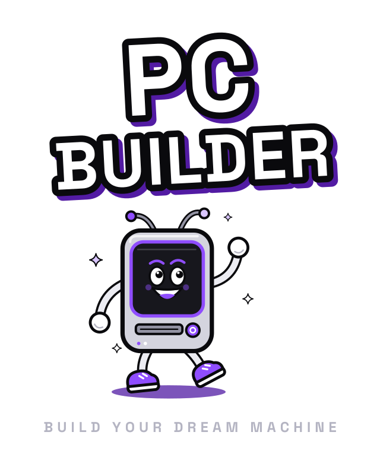

<div align="center">



# PC Builder

**Build your dream machine.**


**Created by Georgederick.**

</div>

## Descrição (PT-BR)

O **PC Builder** é uma plataforma de montagem e configuração de computadores que roda 100% no navegador. Escolha componentes por categoria, valide a compatibilidade entre as peças em tempo real, acompanhe orçamento e consumo, compare especificações, carregue builds prontas e salve ou compartilhe suas configurações. Sem backend, sem cadastro e sem serviços pagos.

## Description (EN)

**PC Builder** is a fully client-side PC building and configuration platform. Pick parts per category, validate compatibility in real time, track budget and power draw, compare specs, load ready-made builds, and save or share your configurations. No backend, no sign-up, no paid services.

## Demonstração / Demo

`https://georgederick.github.io/pc-builder/`


## Funcionalidades

- Dashboard com hero ilustrado, builds populares, categorias, estatísticas e "como funciona".
- Configurador com 10 categorias: CPU, placa-mãe, RAM, GPU, SSD, HDD, fonte, gabinete, cooler e ventoinhas.
- **Compatibilidade com 20 regras**: socket, BIOS, tipo/geração/frequência de RAM, slots e capacidade, formato da placa x gabinete, comprimento da GPU, altura do cooler/radiador, socket do cooler, capacidade térmica, potência da fonte, conectores PCIe/12VHPWR, slots M.2, geração M.2, portas SATA, baias e ventoinhas.
- Quatro estados visuais: Compatível, Atenção, Incompatível e Informação insuficiente. Nunca declara "100% compatível" quando faltam dados.
- Resumo lateral fixo com miniaturas, quantidades, total, consumo estimado e fonte recomendada.
- **Build Overview** com gráficos interativos (distribuição de preço, consumo, preço x desempenho de CPUs) e relatório de compatibilidade com "como resolver".
- **Comparador** de 2 a 4 componentes da mesma categoria, destacando diferenças sem declarar vencedor geral.
- **Ready Builds**: Entry Level, Budget Gamer, Mid Range, High Performance e Enthusiast.
- Salvar, renomear, duplicar, excluir, exportar/importar JSON, versão imprimível e link compartilhável com a montagem codificada na URL.
- Busca, filtros (fabricante, preço, socket, memória, capacidade, frequência, potência...) e ordenação por preço, nome e specs.
- Responsivo, dark mode, microinterações, toasts, modais de confirmação, tooltips e estados vazios.

## Tecnologias

React 18, TypeScript, Vite, Tailwind CSS, Zustand (persistência em LocalStorage), React Router (HashRouter), Recharts e Lucide React.

## Como executar localmente

```bash
npm install
npm run dev
```

## Como realizar o build

```bash
npm run build
npm run preview
```

Para validar a base de dados e as builds prontas com o motor de compatibilidade:

```bash
npm run verify
```

## Como publicar no GitHub Pages

O projeto usa `HashRouter` e `base: './'`, então funciona em qualquer subcaminho sem configuração extra.

1. Crie um repositório (ex.: `pc-builder`) e envie o código para a branch `main`.
2. No GitHub, abra **Settings > Pages** e em **Source** escolha **GitHub Actions**.
3. A cada push na `main`, o workflow `.github/workflows/deploy.yml` faz o build e publica.

## Estrutura de diretórios

```
pc-builder/
├── .github/workflows/deploy.yml
├── public/                  logo.svg, logo-mark.svg, favicon.svg
├── scripts/verify.ts        valida catálogo e builds prontas
├── src/
│   ├── components/          Layout, SummaryPanel, PartCard, PartDetail, ui...
│   ├── config/site.ts       nome, créditos e links das redes (edite aqui)
│   ├── data/                components.json, builds.json, catalog.ts
│   ├── lib/                 compat.ts, power.ts, specs.ts, filters.ts, share.ts...
│   ├── pages/               Home, Builder, Overview, Compare, ReadyBuilds, Saved, Shared, PrintView, About
│   ├── store/useStore.ts    estado global + LocalStorage
│   ├── index.css
│   └── main.tsx
├── index.html
├── tailwind.config.js
├── tsconfig.json
└── vite.config.ts
```

## Base de dados

`src/data/components.json` reúne 101 componentes de fabricantes como AMD, Intel, NVIDIA, ASUS, MSI, Gigabyte, Corsair, Kingston, Samsung, WD, Cooler Master, Noctua e outros. Cada item tem especificações técnicas tipadas (`src/lib/types.ts`).

- **Preços são valores ilustrativos e editáveis** (campo `price` do JSON), não cotações atualizadas.
- Quando uma especificação varia por modelo do fabricante (ex.: comprimento de algumas GPUs) ou não é conhecida, o campo é omitido e a verificação resulta em "Informação insuficiente".
- Revise as especificações nas fichas oficiais antes de qualquer compra.

## Limitações conhecidas

- Sem preços ao vivo nem disponibilidade em estoque.
- As imagens dos produtos são ilustrações geradas, não fotos oficiais.
- O consumo é uma estimativa baseada em TDP/TGP; não substitui medição real.
- O índice de preço x desempenho de CPUs é relativo (threads x clock + cache), não é benchmark.
- Não cobre todos os cenários (overclock, RAM com 4 módulos, compatibilidade de BIOS por revisão de placa).
- Dados salvos ficam apenas no navegador atual; exporte em JSON para backup.

## Créditos

**Created by Georgederick.** Edite os links do GitHub e redes sociais em `src/config/site.ts`.
